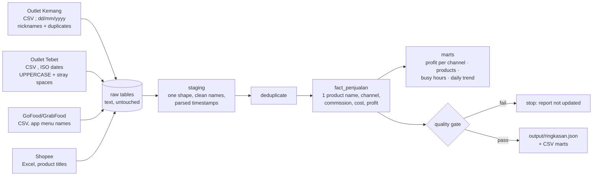

# Kopi Senja sales pipeline

**Messy multi-channel exports → one clean sales table → the numbers a small business owner actually needs. Rebuilt automatically every night.**

> ⚠️ **All data is fictional.** Kopi Senja is a made-up coffee shop used as a demo by [Kemang Data](https://kemangdata.my.id). No real business or personal data is used anywhere in this repository.

This is the engine behind the [Kopi Senja case study](https://kemangdata.my.id/id/umkm-sales-dashboard.html): a coffee shop with two outlets that also sells on GoFood/GrabFood and Shopee. Every channel exports its sales in a different format, so the owner used to spend about four hours a week copying and matching spreadsheets, and still could not see the real profit per channel after app commissions.

## What it does



| Step | File | What happens |
|---|---|---|
| Generate | `kopisenja/generate.py` | Fictional daily exports with realistic problems: 4 different layouts, 3 date formats, 31 spellings of 10 products, stray spaces, ~1% duplicated rows. Deterministic per date, so any history can be rebuilt. |
| Load | `kopisenja/run.py` | Every file is read **as text** into `raw_*` tables. Nothing is guessed or changed at this stage. |
| Staging | `sql/01_staging.sql` | All sources into one shape, names trimmed, timestamps parsed per source, duplicates removed (`row_number()` window). |
| Fact | `sql/02_fact.sql` | Product names matched through `config/alias.csv`, then commission (`config/channel.csv`) and cost of goods (`config/produk.csv`) give the **real profit per line**. |
| Marts | `sql/03_mart.sql` | Profit per channel per month, best sellers and slow movers, busy hours, daily trend. |
| Quality gate | `kopisenja/run.py` | 5 checks. If any fails, the run stops and the published numbers stay as they were. |

### Quality checks
1. Every product name is recognised (a new menu item must be added to `config/alias.csv` first).
2. Revenue reconciles: clean staging total = fact table total.
3. No empty or negative quantities, amounts or timestamps.
4. Every in-store and delivery channel has data for every day of the period.
5. All dates fall inside the requested period.

## Example result (90 days, fictional)

| Channel | Revenue | Profit after commission & cost | Margin |
|---|---|---|---|
| Outlet Kemang | Rp308.8 M | Rp186.4 M | 60.4% |
| Outlet Tebet | Rp210.1 M | Rp127.0 M | 60.4% |
| GoFood/GrabFood | Rp150.3 M | Rp62.0 M | **41.2%** |
| Shopee | Rp27.0 M | Rp13.1 M | 48.6% |

17,681 raw rows → 90 duplicates removed → 31 raw product names → 10 products. Slow movers: Red Velvet Latte, Kue Lumpur Pandan. Busiest hours: 16:00–18:00.
The live numbers are in [`output/ringkasan.json`](output/ringkasan.json), refreshed every night by GitHub Actions.

## Run it

```bash
pip install -r requirements.txt
python -m kopisenja.run                      # last 90 days up to today
python -m kopisenja.run --sampai 2026-11-24 --hari 30
python -m pytest -q                          # 4 end-to-end tests, incl. "broken export is stopped"
```

Outputs land in `output/`: `ringkasan.json` (summary for the website/report) and one CSV per mart.

## Automation

`.github/workflows/nightly.yml` runs every night at 23:00 Jakarta time: tests → full rebuild of the last 90 days → commit the new `output/`. Every run is idempotent: all tables are rebuilt from the raw files, so a re-run never double counts.

## Stack and roadmap

- **Now:** Python, pandas, DuckDB SQL, pytest, GitHub Actions. Free to run.
- **Next:** load the same tables into **BigQuery** (free sandbox) and connect a **Looker Studio** dashboard the owner opens on their phone.
- SQL is written in plain, portable style (window functions, CTEs); DuckDB-specific bits are `strptime`, `regexp_replace(..., 'g')` and `GROUP BY ALL`.

## Using this for a real business

The same pipeline works on a real shop's exports: replace the generator with the shop's files, list their menu spellings in `config/alias.csv`, and set their commissions and costs. That is exactly the service [Kemang Data](https://kemangdata.my.id) offers small businesses.

---
*Bahasa Indonesia:* Pipeline demo (data fiktif) yang menggabungkan export kasir 2 outlet, GoFood/GrabFood dan Shopee menjadi satu tabel penjualan bersih, menghitung untung asli per channel setelah komisi, lalu memperbarui laporannya otomatis setiap malam. Contoh hasil kerja [Kemang Data](https://kemangdata.my.id).

License: MIT
